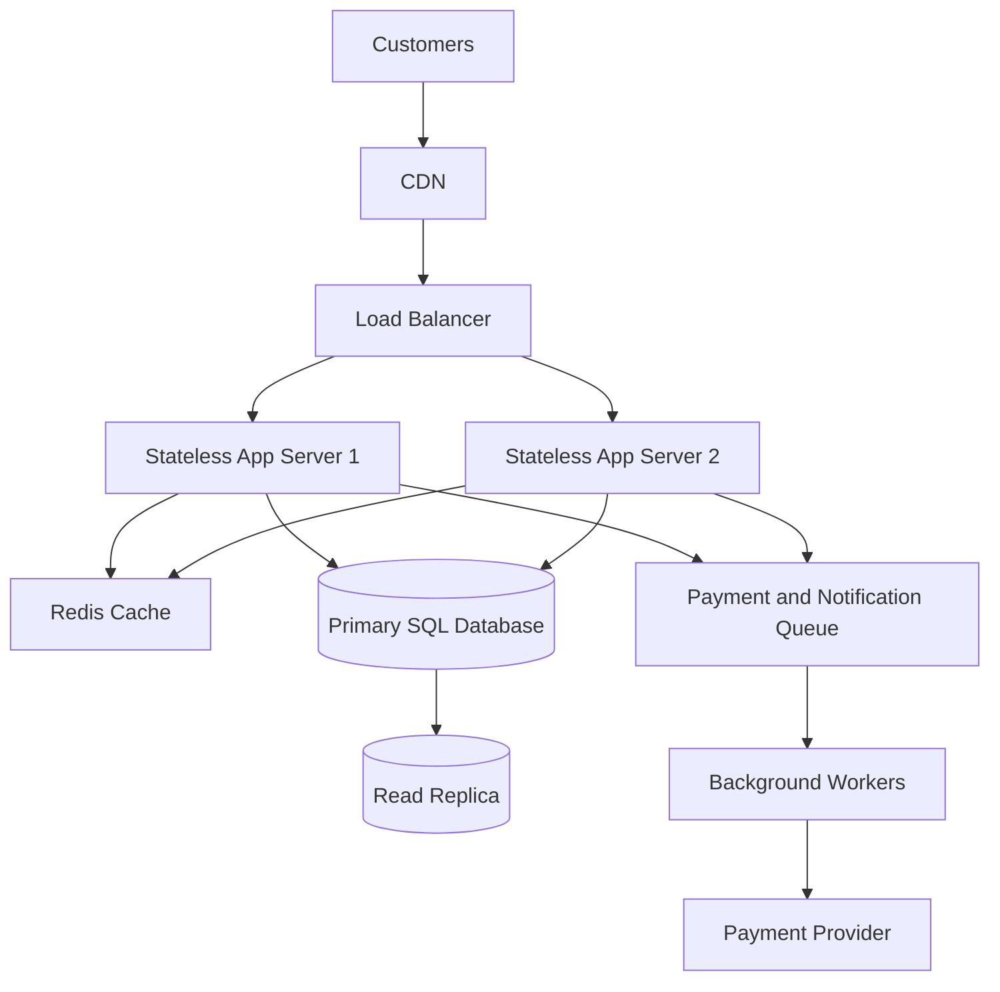

# TicketHub — System Design Document

## 1. Context, Goals and Requirements

### Context

TicketHub is a website where customers can browse concerts and events, select seats, purchase tickets and view their orders. The system must support ordinary daily activity as well as sudden traffic spikes when popular concerts go on sale.

### Goals

- Allow customers to browse events and view available seats.
- Allow customers to temporarily hold seats while completing payment.
- Process payments and confirm successful ticket purchases.
- Prevent two customers from purchasing the same seat.
- Remain responsive and available during high-demand sales.

### Non-goals

- Building a venue seating-management system.
- Managing concert performers or event production.
- Supporting ticket resale between customers.

### Functional requirements

1. Users can register, sign in and manage their accounts.
2. Users can browse and search events.
3. Users can view seat availability for an event.
4. Users can temporarily hold available seats.
5. Users can pay for held seats and receive confirmed orders.
6. Users can view their purchased tickets and order history.
7. Users receive a clear response when a seat is unavailable or a payment fails.

### Non-functional requirements

- **Performance:** Event pages and seat availability should load quickly, with a target of under one second for ordinary browsing under expected load.
- **Correctness:** A seat must never be sold to more than one customer.
- **Availability:** The system should remain accessible during normal traffic and popular sales.
- **Fairness:** Seat holds should have a fixed expiry time so customers cannot reserve seats indefinitely.
- **Security:** Users must only access their own orders and tickets. Payment information must be handled securely by a payment provider.
- **Scalability:** The system should handle sudden increases in browsing and purchase attempts.
- **Reliability:** Failed or repeated payment requests must not create duplicate orders or charges.

## 2. Traffic and Storage Estimates

The assignment provides these facts:

- Registered users: 2,000,000.
- Normal daily visitors: 50,000.
- Pages viewed per visitor: 10.
- Normal daily ticket sales: 5,000.
- Popular sale: 200,000 people attempt to buy 20,000 seats within 10 minutes.

For daily averages, use the course estimate of approximately 100,000 seconds per day.

### Normal traffic

Daily page views:

50,000 visitors × 10 pages = 500,000 page views per day.

Average page views per second:

500,000 ÷ 100,000 = 5 page views per second.

Average ticket sales per second:

5,000 ÷ 100,000 = 0.05 tickets per second.

### Popular concert sale

Ten minutes = 600 seconds.

Average purchase attempts per second:

200,000 ÷ 600 ≈ 333 attempts per second.

Demand compared with available seats:

200,000 people ÷ 20,000 seats = 10 people per seat.

The sale therefore has approximately ten interested buyers for every available seat.

### Comparison

| Measure | Normal day | Popular sale |
|---|---:|---:|
| Visitors or attempts | 50,000 visitors/day | 200,000 attempts/10 minutes |
| Page views | 500,000/day | Not specified |
| Average page views or attempts per second | 5 page views/sec | About 333 attempts/sec |
| Ticket sales or available seats | 5,000 tickets/day | 20,000 seats |

The popular sale creates much greater pressure in a short period. Its average attempt rate is about 67 times the normal average page-view rate (333 ÷ 5).

These figures are not directly equivalent to total API requests. One visitor may make several API requests while browsing and purchasing. The actual request rate will therefore depend on user behaviour.

## 3. API Design

The API uses REST principles. Each endpoint has a clear HTTP method and purpose.

| Method and endpoint | Purpose | Expected response |
|---|---|---|
| GET /events | List and browse events | 200 OK |
| GET /events/{eventId} | View event details | 200 OK or 404 Not Found |
| GET /events/{eventId}/seats | View seats and their availability | 200 OK |
| POST /events/{eventId}/holds | Temporarily hold selected seats | 201 Created or 409 Conflict |
| POST /orders | Create an order for held seats and initiate checkout | 201 Created or 409 Conflict |
| POST /orders/{orderId}/payment | Process payment for an order | 200 OK or 402 Payment Required |
| GET /users/me/orders | View the signed-in user's orders | 200 OK |
| GET /orders/{orderId} | View order details | 200 OK or 404 Not Found |

### Example: Hold seats

Request:

POST /events/101/holds

```json
{
  "seatIds": [501, 502]
}
```

Successful response:

```json
{
  "holdId": 9001,
  "seatIds": [501, 502],
  "status": "HELD",
  "expiresAt": "2026-11-01T12:10:00Z"
}
```

If another customer already holds or has purchased one of the requested seats, the API returns `409 Conflict`. The customer must select another available seat.

### Example: Create an order

Request:

POST /orders

```json
{
  "holdId": 9001
}
```

The server verifies that the hold belongs to the signed-in user and has not expired before creating the order.

### Example: View events

Request:

GET /events

Successful response:

```json
{
  "events": [
    {
      "id": 101,
      "name": "Summer Music Festival",
      "venue": "Main Arena",
      "date": "2026-12-15"
    }
  ]
}
```

The API requires authentication for holding seats, placing orders, making payments and viewing private order information.

## 4. Data Model

The design uses a relational SQL database because users, events, seats and orders have clear relationships, and ticket sales require strong consistency.

### Tables

#### Users

| Column | Type | Constraint |
|---|---|---|
| id | BIGINT | Primary key |
| name | VARCHAR(150) | NOT NULL |
| email | VARCHAR(255) | UNIQUE, NOT NULL |
| password_hash | TEXT | NOT NULL |
| created_at | TIMESTAMP | NOT NULL |

#### Events

| Column | Type | Constraint |
|---|---|---|
| id | BIGINT | Primary key |
| name | VARCHAR(200) | NOT NULL |
| venue | VARCHAR(200) | NOT NULL |
| event_date | TIMESTAMP | NOT NULL |
| status | VARCHAR(30) | NOT NULL |

#### Seats

Each seat belongs to one event.

| Column | Type | Constraint |
|---|---|---|
| id | BIGINT | Primary key |
| event_id | BIGINT | Foreign key to Events |
| seat_number | VARCHAR(30) | NOT NULL |
| status | VARCHAR(20) | NOT NULL |
| held_by_user_id | BIGINT | Nullable foreign key to Users |
| hold_expires_at | TIMESTAMP | Nullable |

A unique constraint on `(event_id, seat_number)` prevents the same seat from being entered twice for one event.

Seat status can be `AVAILABLE`, `HELD` or `SOLD`.

#### Orders

| Column | Type | Constraint |
|---|---|---|
| id | BIGINT | Primary key |
| user_id | BIGINT | Foreign key to Users |
| status | VARCHAR(30) | NOT NULL |
| total_amount | DECIMAL(10,2) | NOT NULL |
| created_at | TIMESTAMP | NOT NULL |

#### Order_Items

This table connects orders to the individual seats being purchased.

| Column | Type | Constraint |
|---|---|---|
| id | BIGINT | Primary key |
| order_id | BIGINT | Foreign key to Orders |
| seat_id | BIGINT | Unique foreign key to Seats |
| price | DECIMAL(10,2) | NOT NULL |

The unique constraint on `seat_id` ensures that a seat cannot appear in two different order items.

### Relationships

- One user can create many orders.
- One event can contain many seats.
- One user can temporarily hold many seats.
- One order can contain many order items.
- Each order item refers to one seat.
- Each seat belongs to one event.

The database uses primary keys to identify records and foreign keys to maintain relationships.

## 5. Preventing Double-Booking

This is one of the most important requirements in TicketHub.

Imagine two customers attempt to buy seat A12 at almost exactly the same time. The system must ensure that only one succeeds.

### Step 1: Start a database transaction

When a customer requests a seat hold, the application starts a database transaction and locks the selected seat row using a row-level lock, such as `SELECT ... FOR UPDATE`.

### Step 2: Check availability

While holding the lock, the application checks whether the seat is:

- Available; or
- Held by another customer with a hold that has not expired; or
- Already sold.

An expired hold can be treated as available and released.

### Step 3: Assign the hold

If the seat is available, the application updates its status to `HELD`, records the customer and sets an expiry time.

For example, a hold could last five minutes. This is a proposed design choice, not a supplied assignment requirement.

### Step 4: Commit the transaction

The application commits the transaction. Another customer attempting to lock the same seat must wait until the first transaction finishes. They then see the updated status and cannot obtain the same hold.

### Step 5: Confirm payment and sale

After successful payment, the application starts another transaction. It verifies that the hold belongs to the customer and is still valid, then changes the seat status to `SOLD` and confirms the order.

If payment fails or the hold expires, the seat can be released for other customers.

### Additional database protection

The unique constraint on `Order_Items.seat_id` provides another layer of protection against a seat being assigned to multiple completed orders.

Payment requests should also use idempotency keys. This means repeating the same payment request does not accidentally create multiple charges or orders.

The combination of transactions, row-level locking, seat status checks and database constraints prevents two customers from successfully buying the same seat.

## 6. High-Level Architecture

### Architecture diagram



### Component explanations

1. **Customers:** Use the TicketHub website to browse events, select seats and purchase tickets.
2. **CDN:** Serves static files such as images, CSS and JavaScript from locations closer to users, reducing loading times.
3. **Load balancer:** Distributes incoming requests across multiple application servers so that one server does not handle all the traffic.
4. **Stateless application servers:** Handle API requests and business logic. They do not store important customer or seat information only in their own memory.
5. **Redis cache:** Stores frequently requested event information and other suitable read data to reduce repeated database queries. Seat availability must still be verified against the primary database before a hold is accepted.
6. **Primary SQL database:** Stores users, events, seats, holds and orders. Seat-hold and purchase transactions are handled here to preserve correctness.
7. **Read replica:** Handles suitable read queries, reducing pressure on the primary database. Seat availability checks used to make purchase decisions must use the primary database to avoid stale results.
8. **Queue:** Holds background tasks, such as sending confirmation emails and notifications, so these tasks do not delay the main purchase request.
9. **Background workers:** Process queued tasks.
10. **Payment provider:** Processes customer payments. The application confirms an order only after verifying the payment result.

### How the architecture handles a popular sale

- The CDN serves static website content without sending every request to the application servers.
- The load balancer distributes requests across multiple stateless servers.
- Redis reduces database work for frequently accessed event information.
- The primary database protects seat availability using transactions and row-level locks.
- Read replicas handle suitable browsing queries, while critical seat checks remain on the primary database.
- Queues and workers process non-essential background tasks outside the main purchase flow.
- Database monitoring and capacity planning help identify when additional resources are needed.

The system must not rely on the cache alone to decide whether a seat can be sold. The primary database remains the source of truth.

## 7. Trade-offs and Alternatives

### Trade-off 1: SQL database versus NoSQL database

A relational SQL database provides transactions, constraints and relationships that are important for preventing double-booking.

The trade-off is that a highly loaded relational database may require careful scaling and query optimisation. A NoSQL database may offer flexible data structures and different scaling options, but maintaining strong seat-purchase consistency would require careful design.

For TicketHub, SQL is selected because correctness of ticket ownership is more important than flexible data structures.

### Trade-off 2: Caching versus data freshness

Redis makes popular event information faster to retrieve and reduces database load.

However, cached information can become stale. A customer might see a seat as available even after another customer has held it.

The design therefore uses caching for suitable browsing information but checks the primary database before granting a seat hold.

### Trade-off 3: Temporary holds versus immediate purchasing

Temporary holds give customers time to complete payment and make the process fairer.

However, holds can temporarily prevent other customers from buying seats, even when the first customer does not complete payment.

The design uses short hold expiry times and releases expired holds so that abandoned reservations do not block seats indefinitely.

### Trade-off 4: Read replicas versus consistency

Read replicas reduce pressure on the primary database and improve the capacity for browsing.

However, replicas can lag behind the primary database. A recent seat purchase might not immediately appear in a replica's data.

For that reason, critical seat availability and purchase decisions use the primary database.

## 8. Risks and Open Questions

- A payment provider may be temporarily unavailable, so the system needs a safe retry and order-reconciliation process.
- A sudden sale may generate more traffic than the estimated average, requiring load testing and capacity planning.
- Database failure could interrupt purchases, so backups and a tested recovery plan are necessary.
- The business must decide the exact hold duration and whether customers may hold multiple seats.
- The payment provider, supported payment methods and refund process must be selected.
- The system needs monitoring for response times, failed payments, database load, queue delays and seat-hold conflicts.

## Conclusion

TicketHub needs to support ordinary browsing while protecting the correctness of ticket purchases during sudden demand spikes. The design uses stateless application servers, a load balancer, Redis caching, a relational SQL database, read replicas and background workers.

The most important protection is the database transaction that locks a seat while its availability is checked and its hold is assigned. Database constraints provide an additional safeguard. These choices allow the system to scale while ensuring that one seat cannot be successfully sold to two customers.
